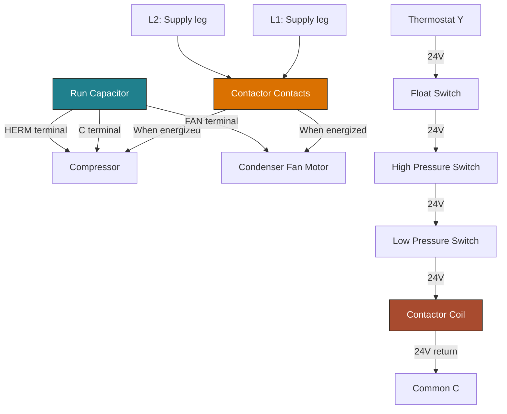

# Contactor & Capacitor Motor Circuit Diagram (Mermaid)

Conceptual example only, not a wiring or live-testing procedure. Actual voltages,
capacitor connections, and safety-circuit arrangements vary; use the exact
manufacturer schematic. Read [Safety and Authorization Boundaries](../SAFETY.md).

## Capacitor Terminal Guide

| Terminal | Connects To |
|----------|-----------|
| C (Common) | Line power + run winding |
| HERM | Compressor start/run winding |
| FAN | Condenser fan motor |

## Safety

**Capacitors store energy even when power is off.**
Use the equipment manufacturer's stored-energy, discharge, waiting, and verification
procedure with approved rated tools and qualified personnel. This diagram provides
no universal resistor value, wait time, or instruction to improvise terminal shorting.

## Contactor Testing

An open/de-energized contactor coil does not mean its line terminals are isolated.
Do not use contact position or a click as proof of safety. Use the applicable
isolated-work inspection method; refer required energized electrical testing
to qualified, authorized personnel under their approved procedure.

## Capacitor Testing

| Test | Method | Expected |
|------|--------|----------|
| Capacitance | Approved isolated/stored-energy-safe method | Component marking and manufacturer tolerance |
| Visual | Inspect top and body | No bulging, leaking, or case damage |
| Insulation condition | Manufacturer-specified test by qualified personnel | A continuity reading alone does not certify insulation or safety |
